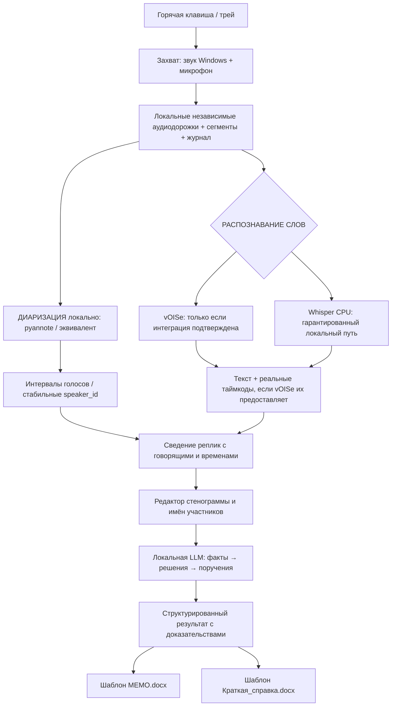

# Meeting Memo — техническое задание и порядок разработки для Codex

**Версия:** 2.0 · **Дата:** 14.10.2026 · **Платформа:** Windows, CPU-only · **Стадия:** MVP  
**Назначение файла:** самостоятельная реализация приложения в VS Code/Codex по этапам с обязательной проверкой каждого этапа.  
**Парный документ:** `Meeting_Memo_Инструкция_по_разработке.docx` — краткий порядок запуска и контроля.

> **Инструкция Codex.** Прочитай этот файл полностью до разработки. Работай **строго последовательно по P0–P5**; между этапами останавливайся и запрашивай приёмку. Создавай действующий код, тесты и инструкции запуска, а не визуальные заглушки. По окончании каждого этапа выдавай краткий отчёт по форме §12. Не заявляй, что функция работает, пока её не проверил на Windows или не обозначил непроверенной. Общайся на русском. Если доступ к Windows/звуковым устройствам из текущего окружения отсутствует, подготовь код и локальный тест, но **не выдавай это за успешное испытание записи**.

## 0. Суть продукта и границы MVP

Пользователь нажимает **одну глобальную горячую клавишу** (по умолчанию `Ctrl+Alt+R`) или кнопку трея → начинается **видимая** запись звука компьютера и микрофона (Skype, Teams, браузер, видео и пр.) → повторное нажатие останавливает запись → аудио надёжно сохраняется локально → программа выполняет **распознавание речи и разделение участников по голосам** → показывает редактируемую стенограмму `Участник 1`, `Участник 2`, … → локальная текстовая модель выделяет решения, поручения и открытые вопросы → создаёт **МЕМО.docx** и **Краткая_справка.docx** по шаблонам.

**Ключевые условия, подтверждённые для проекта:**

- Windows; **дискретной видеокарты нет**. Точные CPU/ОЗУ пока неизвестны и диагностируются на P0.
- vOISe — **внутреннее веб-приложение**. Его API, режим выгрузки, таймкоды, ограничение на размер/длительность и возможность автоматизации **не подтверждены**.
- Аудио/транскрипты/документы — **только локально или во внутреннем разрешённом корпоративном контуре**. Внешние ASR/LLM API, телеметрия, облачная синхронизация и отправка рабочих данных в облако запрещены.
- **Диаризация обязательна сразу.** Имена участников не обязательны: по умолчанию `Участник 1`, `Участник 2`, …; один голос должен сохранять один номер в пределах одной встречи. Ручное переименование глобально для записи.
- Требуются **новые** редактируемые Word-шаблоны двух документов.
- Целевой проверочный сценарий — **4-часовая запись**; это не искусственный лимит приложения.
- После установки одобренных локальных моделей **обработка должна работать без интернета**, пусть и медленно. Доступность vOISe не должна препятствовать записи и локальному режиму.
- Результат — **Windows-приложение**, а не браузерная демонстрация и не один консольный скрипт.

### Не входит в MVP

Отправка писем, создание Jira/Confluence-задач, интеграция с календарём, распознавание личности по биометрической базе, скрытая запись, постоянное прослушивание, запись видео/экрана, облачные сервисы, коллективная серверная платформа. Не начинать это без отдельного запроса.

## 1. Главная схема — разделять звук, голос, слова и смысл



**Не смешивать понятия:**

- **ASR** распознаёт *что сказано* и возвращает интервалы слов/реплик.
- **Диаризация** определяет *когда и какой голос говорил*. Она не определяет реальные ФИО.
- **Сведение** привязывает интервалы ASR к голосовым сегментам. Если пересеклись голоса или данных мало — `speaker_id=null`/`Не определён` и флаг проверки.
- **LLM** лишь систематизирует уже распознанные факты; она не должна дорисовывать услышанное или «угадывать» говорящих.

**Критическое условие vOISe:** если он выдаёт только общий TXT/DOCX без таймкодов, **нельзя** автоматически назначить каждой фразе голос по положению текста. Нужны достоверные таймкоды локального ASR или проверенное *локальное* выравнивание. В этом случае vOISe допустим как альтернативный текст для ручного сравнения/коррекции, но не как единственный источник стенограммы по участникам. Путь **Whisper CPU + локальная диаризация** поэтому является обязательной технической гарантией MVP.

## 2. Технологический стек и решения P0

| Модуль | Рекомендуемая основа | Что уточнить до фиксации |
|---|---|---|
| Desktop UI | Python 3.11/3.12 + PySide6 | Доступность на корпоративной Windows; поддержка трея/overlay |
| Хоткей | Windows `RegisterHotKey` + Qt native events | Коллизии сочетаний, поддержка переключения |
| Системный звук | WASAPI loopback (`PyAudioWPatch` либо эквивалент) | Выбранное устройство, USB/Bluetooth, real loopback на этой Windows |
| Микрофон | отдельный Windows/WASAPI audio stream | Временная синхронизация двух потоков |
| Запись | WAV/FLAC, атомарные сегменты, SQLite/JSON manifest | Повреждение/восстановление после завершения процесса |
| ASR локально | `whisper.cpp`, многоязычные CPU-модели с таймкодами | Скорость/точность на русском и терминологии OIS |
| Диаризация | `pyannote/speaker-diarization-community-1` CPU | Условия доступа/лицензия; одобренная доставка весов; Windows/PyTorch |
| vOISe | изолированный provider с ручным и автоматическим режимами | API/SSO/выгрузка/таймкоды/внутренние правила |
| Анализ текста | Ollama + разрешённая небольшая локальная quantized LLM (например Qwen3 4B) | **RAM, скорость, качество**; не считать модель утверждённой заранее |
| Данные | Pydantic + SQLite/JSON, версия схемы | Стабильное повторное выполнение стадий |
| Word | `docxtpl` + `python-docx` | Реальные шаблоны, открытие в Word |
| Поставка | venv и проверенный installer/portable pack (PyInstaller после тестов) | Установка Python/весов может требовать ИБ |
| Тесты | pytest + синтетические/разрешённые образцы | Никаких рабочих аудио в Git/Codex-контексте |

**Правило по pyannote:** официальный Community-1 использует лицензирование CC BY 4.0 и предполагает принятие условий доступа при загрузке весов; есть документированный локальный режим. Получать модель только по разрешённому процессу. Не обходить аутентификацию, не сохранять токены в коде. При невозможности установки предложить разрешённый альтернативный локальный движок и **остановить приёмку P2**, пока реальная диаризация не доказана. Ссылки в §13.

**Ограничение CPU:** не загружать одновременно тяжёлые ASR, diarization и LLM. Проводить стадии отдельными worker-процессами и очищать RAM после каждого. GUI должен оставаться отзывчивым. Не обещать время обработки до фактических замеров P0/P2/P3.

## 3. Требования к пользовательскому приложению

### F01 — Запуск и индикация

- Одна настраиваемая глобальная комбинация (дефолт `Ctrl+Alt+R`), команда start/stop из трея. Повторный start не создаёт вторую запись.
- Маленький **всегда видимый индикатор** в выбранном углу экрана: красная точка, таймер, видимый уровень звука и кнопка STOP. Индикация реальной записи обязательна; окно можно передвинуть и сохранить положение.
- Состояния интерфейса: `Готово`, `Запись`, `Сохранение`, `В очереди`, `Распознавание`, `Разделение голосов`, `Анализ`, `Документы готовы`, `Ошибка` и `Ожидание подтверждения`.
- После остановки — корректно завершить сегмент, зафиксировать итоговую длительность и предложить обработку автоматически (в настройках — вариант вручную).
- Не запускать запись скрытно или автоматически при открытии звонка. Напоминать о согласовании записи, если это необходимо по внутренним правилам.

### F02 — Надёжная запись

- Одновременно два **исходных независимых потока**: звук активного выхода Windows (loopback) и микрофон. Понятный выбор устройств в настройках, тест 10 секунд до начала.
- Записывать небольшими сегментами (ориентир 2–5 минут) с метаданными: id, время начала, длительность, аудиоформат, источник, контрольная сумма/размер, успешность закрытия.
- Не считать `write()` файла достаточным подтверждением целостности; сегмент завершать атомарно. При аварии восстановить все уже закрытые фрагменты и явно показать возможную утрату последнего.
- Исходники не перемешивать; для ASR/diarization готовить согласованную моно-копию 16 кГц с корректным смещением двух дорожек. Не создавать эхо из повторного попадания собеседника в микрофон.
- Сценарии: микрофон замолчал; вывод в другие наушники; сеть пропала; диск заполнился; устройство отключили; приложение принудительно завершено; горячая клавиша занята.
- Реальные тесты аудиоустройств проводятся **на Windows**. Linux/виртуальная среда не доказывает работу loopback.

### F03 — Диаризация с сохранением личности голоса

- Должно быть реально выполненное **разделение голосов по аудиосигналу**, не заглушка по чередованию строк. Присваивать `speaker_1`, `speaker_2`, ... по порядку первого уверенного появления.
- Стабильность между далёкими фрагментами одной записи обязательна; голос в начале и конце одной встречи должен сохранять свой ID.
- При обработке аудио кусками **не переиспользовать локальные ID чанков как глобальные**: нужна проверенная глобальная кластеризация/сопоставление голосовых векторов **или** единый проход диаризации по всей встрече, если позволяет CPU/память.
- Если реплика неоднозначна, есть перекрытие голосов или низкая уверенность — `Не определён` и `needs_review=true`, не приписывать случайно.
- При известной сложности записи количество участников может подсказать пользователь (не обязательное условие). Отдельно учитывать, что микрофон — канал собственного голоса, но удалённых собеседников один системный канал не разделяет.
- Редактор позволяет менять имена `Участник N → Иван И.И.` с применением ко всем репликам, фактам и новым DOCX, не меняя исходное аудио. Если человек **явно представился** на записи, система может предложить привязку имени к голосу только со ссылкой на конкретную реплику и подтверждением пользователя; без этого — нейтральное «Участник N».
- В P2 провести тест на **минимум 3 разных голосах** и повторном появлении первого после паузы. Метрики: фактическое число найденных голосов, число неправильных приписываний, `Не определён`, непрерывность ID, скорость и RAM. Точность ниже согласованного порога — **блокер P2**, а не повод скрыть неуверенные фразы.

### F04 — ASR и привязка реплик ко времени

- Обязательный **локальный CPU-ASR** с относительными интервалами в секундах, русским языком и возможностью коррекции технических терминов. Названия вроде OIS, QAS, ОПЭ, ПСИ не заменять по догадке.
- Переключаемые providers: локальный; vOISe (если подтверждён); импорт TXT/DOCX/SRT/VTT. Импорт без интервалов **не может** по умолчанию считаться полноценной стенограммой с говорящими.
- Совмещать diarization и ASR по проверяемым временным отметкам. Когда есть только крупные ASR-сегменты, избегать принудительного назначения одному голосу текста, который произнесли несколько человек; можно использовать более мелкое выравнивание, но его качество проверяется отдельно.
- Хранить: интервалы и текст из первичного ASR, результат диаризации и сведённую стенограмму — раздельно. Ручные правки не затирают первичные данные.
- Нужен редактор с `время | участник | реплика`, фильтром «Требует проверки», перемоткой исходного аудио к фрагменту, поиском, правкой реплики и массовым переименованием голоса.

### F05 — vOISe как подключаемый внутренний сервис

- Сначала описать **реальное** поведение портала: поддерживаемый ввод (форматы/размер/длительность), запуск задания, статус, загрузка результата, наличие таймкодов и меток голосов, разрешение на автоматизацию.
- Предпочтение разрешённому официальному API. Если API отсутствует, Playwright через штатные DOM-элементы с разрешённой учётной записью; не обходить SSO, CAPTCHA, блокировки, политики ИБ или ограничения эксплуатации.
- Если автоматизация запрещена/не работает — **режим с ручной загрузкой и импортом результата**, при этом программа и локальный путь остаются работоспособны.
- Не хранить пароль или SSO cookie в Git, .env под версионным контролем, журнале или дампах. Не логировать содержимое совещания в браузерные трассировки.
- Сеть только к явно разрешённому адресу внутреннего vOISe, без несанкционированных запросов. Пропажа сети не останавливает запись и не удаляет незавершённые задания.
- Только **реальные** таймкоды позволяют использовать vOISe в автоматическом сведении с голосами. Если таймкодов нет, не выдавать имитацию точности.

### F06 — Локальная подготовка МЕМО

- Локальная LLM получает **текст**, а не доступ к другим рабочим данным/БД. Обработка порциями с ограничением длины и сохранением промежуточных результатов.
- Этапы: `исходные реплики → факты с привязкой к репликам → консолидация → различение решений и намерений → проверка повторов/противоречий → memo.json → DOCX`.
- Типы фактов: `обсуждалось`, `установлено`, `решено`, `поручено`, `открытый вопрос`, `проблема`. У каждого факта должен быть `evidence_utterance_ids`, исходное время, текст основания и `needs_review`.
- Не придумывать: участников, даты, ответственных, сроки, статус завершённости, решения. Предложения и вопросы не превращать в утверждённые договорённости. При неизвестном — пустое поле/«не указано» и пометка проверки.
- Если в начале решили A, а позднее **однозначно** отменили и приняли B, в итоговом МЕМО указать B, но сохранить ссылки на A и B в структурированном результате. При сомнении не выбирать без человека.
- Модель/веса должны быть установлены разрешённым способом. При недоступной LLM документ нельзя выдавать за «автоматически подготовленный»: разрешить ручные отметки/экспорт стенограммы и статус «ожидает модель».
- В UI иметь экран предварительного просмотра извлечённых поручений/решений с возможностью ручной корректировки до формирования DOCX и кнопку «Сформировать заново» без повторного ASR.

### F07 — Два нормальных шаблона Word

- Создать **реальные** `templates/memo_template.docx` и `templates/brief_template.docx` с единым аккуратным стилем; текст, таблицы и заголовки редактируемые.
- **МЕМО:** название, дата, проект/тема (вводятся или подтверждаются пользователем), участники (имена после переименования или `Участник N`), ключевые обсуждённые вопросы, решения, поручения (что / кому / срок, когда они названы), открытые вопросы. Без стенографического пересказа.
- **Краткая справка:** тема/дата, суть встречи в нескольких предложениях, 3–7 действительно основных итогов, проблемные вопросы и что требует внимания. Ориентир — одна страница, но не удалять важное ради искусственного лимита.
- Отдельно сохранять стенограмму **с номерами говорящих**, временными отметками и пометками неопределённости в редактируемом TXT/JSON (экспорт стенограммы в DOCX — желательно, но не заменяет два обязательных документа).
- Не перезаписывать правленые человеком DOCX без подтверждения; выдавать версионное имя при повторной генерации. Проверять открытие файла через `python-docx` и при наличии Word визуально.

### F08 — История, очередь, локальное хранение и безопасность

- Корневая папка по умолчанию `%LOCALAPPDATA%\MeetingMemo\data\` (не каталог репозитория и не синхронизируемый облачный диск); путь можно изменить только на разрешённый локальный или внутренний защищённый каталог. Если системная политика перенаправляет каталог в облако, запись не начинать без выбора безопасного пути.
- У встречи UUID + безопасная папка с датой/темой. В ней: `audio/`, `manifest.json`, `asr_raw.json`, `diarization_raw.json`, `transcript.json`, `facts.json`, два `.docx`, статус обработки и краткие диагностические сведения **без текста совещания**.
- Состояния заданий сохраняются, поддерживаются перезапуск определённого этапа, повтор после ошибки и отмена обработки без удаления аудио.
- Хранить аудио до явного действия пользователя или подтверждённой политики хранения. Не отправлять его в исходники, логи, Codex, публичные CI.
- `.gitignore`: `*.wav`, `*.flac`, пользовательские сессии, модели, токены, `.env`, дампы, промежуточные результаты, профили браузера. Отдельный каталог fixture с синтетическими примерами.
- При работе Codex с подключённым облачным backend **запрещать чтение исходных корпоративных записей в контекст AI**. Codex видит код/обезличенные или синтетические результаты, а реальные тесты запускаются локально и оцениваются человеком. При необходимости закрытого контекста не использовать облачный Codex для этих данных.

## 4. Схема данных — минимальный обязательный контракт

```json
{
  "meeting_id": "UUID",
  "metadata": {"title": "Совещание", "date": "2026-10-14", "duration_sec": 3600},
  "speakers": [
    {"id": "speaker_1", "name": "Участник 1", "renamed_by_user": false},
    {"id": "speaker_2", "name": "Участник 2", "renamed_by_user": false}
  ],
  "utterances": [
    {"id": "utt_0001", "from_sec": 4.2, "to_sec": 9.8, "speaker_id": "speaker_1", "text": "Добрый день...", "needs_review": false, "timestamp_source": "local_asr"},
    {"id": "utt_0002", "from_sec": 10.1, "to_sec": 14.7, "speaker_id": null, "text": "...", "needs_review": true, "timestamp_source": "local_asr"}
  ]
}
```

```json
{
  "type": "action",
  "text": "Согласовать перечень замечаний",
  "owner_speaker_id": null,
  "deadline": null,
  "evidence_utterance_ids": ["utt_0081", "utt_0082"],
  "needs_review": true
}
```

Pydantic-схемы должны валидировать интервалы, существование speaker/utterance IDs и обязательную проверку `evidence_utterance_ids`. Формирование Word — детерминированное из валидационного JSON, не через генерацию DOCX непосредственно моделью.

## 5. Структура проекта (ориентир; не плодить модули без необходимости)

```text
MeetingMemo/
  Meeting_Memo_Codex_TZ.md
  README.md
  pyproject.toml  +  lock-файл после P0
  .gitignore
  src/meeting_memo/
    app.py, settings.py
    ui/                  # окно, трей, индикатор, история, редактор реплик
    audio/               # устройства, захват, сегменты, восстановление
    asr/                 # whisper, vOISe, import; единый ASRResult
    diarization/         # pyannote или заменитель, стабильные speaker_id
    alignment/           # интервалы + speaker turns
    analysis/            # chunking, facts, consolidation, schema validation
    documents/           # шаблоны, docx, версия файла
    core/                # задачи, состояния, SQLite/JSON, ошибки
  templates/memo_template.docx
  templates/brief_template.docx
  tests/unit/
  tests/integration/
  tests/fixtures/      # только синтетика/разрешённые данные
  scripts/diagnose_windows.ps1
  docs/ARCHITECTURE.md
  docs/TESTS.md
  docs/VOISE.md
  docs/HANDOFF.md
```

**Поставку моделей отделить от установщика.** Если модели крупные/регулируются доступом, приложение должно позволять выбрать одобренный локальный каталог с весами, валидировать модель и показывать ясную диагностику, а не скачивать её молча.

## 6. ЭТАП P0 — диагностика и проверка самого рискованного

**Цель:** до основной разработки проверить, что выбранная архитектура возможна на данной Windows и разрешена для данных.

**Codex выполняет:**

1. `scripts/diagnose_windows.ps1`: версия Windows, Python, CPU, ОЗУ, свободное место, устройства ввода/вывода, доступность WASAPI loopback, права на установку/модели. Не выводить секреты и персональные данные.
2. Мини-тест записи **10–20 секунд** из системного выхода и микрофона с последующим воспроизведением.
3. Измерение запуска доступной CPU-ASR и **реальной диаризации минимум двух голосов** на синтетическом/разрешённом файле. Если модель не скачана — фиксировать точную процедуру разрешённой установки, без фиктивного успеха.
4. Проверка локальной LLM на нейтральном фрагменте: время, RAM, валидный JSON-факт с указанием реплики.
5. `docs/VOISE.md`: что известно о веб-интерфейсе и что требует скриншотов/доступа. **Не автоматизировать SSO в P0**.
6. Зафиксировать `docs/ARCHITECTURE.md`, реальные ограничения, выбранные версии, ориентировочное место и риски.

**Передать для приёмки:** диагностический отчёт `docs/P0_REPORT.md`, команды запуска мини-тестов, результаты (время/ОЗУ, путь тестового аудио без секретов), перечень блокеров/разрешений. **Стоп**, если не работает захват обоих источников, недоступна диаризация или не согласован способ установки моделей. Допускается временно продолжить UI/запись при отдельном явном решении пользователя, но P2 всё равно заблокирован.

## 7. ЭТАП P1 — полноценная запись и интерфейс

**Codex выполняет:** реальный desktop-трей + горячая клавиша + плавающий индикатор, выбор устройств, запись независимых дорожек в сегменты, manifest, корректный stop, восстановление сегментов, очередь заданий и экран истории. GUI не зависает. После записи создаётся локальная сессия с реальным аудио.

**Проверяем вручную на Windows:** 30 секунд (говорит микрофон и играет системный звук одновременно), 15 минут, горячая клавиша дважды, изменение громкости, отключение сети, аварийный stop. Воспроизвести обе дорожки и сверить длительность/уровень. **Нельзя принимать только микрофон, пустую дорожку или фейковую индикацию.**

**Артефакты:** запущенная программа, README запуска, `tests/` для состояний/сегментов, `docs/P1_REPORT.md`. Стоп до приёмки.

## 8. ЭТАП P2 — русская расшифровка и реальные «Участник 1, 2, 3»

**Codex выполняет:** CPU-ASR с таймкодами, offline diarization, корректное глобальное сопоставление ID голосов, алгоритм согласования реплик по временным интервалам, редактор стенограммы, перемотку к реплике, ручное переименование говорящего, экспорт `transcript.json`/TXT.

**Тест:** разрешённый файл **3 голоса, 5–10 минут**, где первый участник говорит в начале и конце; ещё один образец с перебиванием. Оценить число голосов, ошибки, `Не определён`, стабильность идентификаторов, скорость CPU. Не использовать «Участник 1/2/3» по очереди строк. Если vOISe ещё не подключён — использовать только local ASR, это штатный ход.

**Критерий приёмки:** участники реально различаются и глобальные ID не перенумеровываются при смене чанков; сомнительные места помечены, ручная правка работает. Если голосов недостаточно или смешиваются — не «сдать P2», а показать диагностику и предложить корректировку/другую модель. Артефакт `docs/P2_REPORT.md` + воспроизводимый тест на разрешённом файле. Стоп до приёмки.

## 9. ЭТАП P3 — локальная аналитика и настоящие Word-документы

**Codex выполняет:** локальный chunk→facts→consolidation pipeline, строгий JSON с ссылками на реплики, экран предварительной проверки, два Word-шаблона, генератор DOCX и повторная генерация после исправления имён/фактов.

**Тестовые случаи на синтетическом тексте:**

1. «Нужно обсудить возможность переноса» — **не** фиксировать как решение о переносе.
2. «Сначала договорились на вторник, затем перенесли на четверг» — итог четверг, ссылки на обе реплики.
3. «Кто возьмёт эту задачу?» без ответа — **нет** назначенного исполнителя.
4. «Сделали на прошлой неделе» — это факт обсуждения, не новое поручение.
5. Не указаны имена/сроки — не выдумывать, показывать «не указано».
6. Модель недоступна — не выдавать фиктивное МЕМО, предложить повтор/ручную подготовку.

**Критерий:** `memo_template.docx` и `brief_template.docx` реально существуют, содержательные DOCX открываются Word, правятся, имеют информацию из реплик без придуманных решений. `docs/P3_REPORT.md` + примеры **только из синтетики**. Стоп до приёмки.

## 10. ЭТАП P4 — интеграция vOISe без блокирования локального контура

**Codex выполняет:** проверку веб-функций на разрешённой тестовой учётной записи и **только после согласования**. Реализовать один из режимов:

- **A. Подтверждённый API**: клиент upload→status→download, обработка ошибок/лимитов.
- **B. Разрешённая UI-автоматизация**: Playwright с доступными по DOM элементами, обычным входом пользователя, проверкой результата.
- **C. Без разрешённой автоматизации**: открытие портала и понятный ручной импорт выгрузки; статус «автоматизация vOISe недоступна/не разрешена».

Если нет меток времени — vOISe не является полноценным timed ASR-provider для diarization. Локальная расшифровка должна продолжать работать независимо. Автоматический vOISe требует подтверждённой работы и отсутствия запрещённых обходов; fallback всегда доступен.

**Критерий:** либо доказан полный цикл vOISe на разрешённой записи, либо честно реализован режим импорта и зафиксирован blocker автоматизации. `docs/VOISE.md` содержит проверенные ограничения и способ работы. Нельзя выдавать имитацию API за интеграцию. Стоп до приёмки.

## 11. ЭТАП P5 — сборка, устойчивость, передача

**Codex выполняет:** сценарии повторной обработки и восстановления, измерение скорости/RAM, проверку длительной записи, журнал состояния без чувствительного контента, безопасную сборку Windows, локальную установку без внешних вызовов, инструкцию для повторения на другом разрешённом ПК.

**Обязательные проверки:**

- запись 2 ч; по возможности отдельный тест 4 ч; размер файла/время совпадают, нет скрытого прекращения записи;
- записать при пропаже сети, после её появления продолжить задание;
- прервать анализ и повторить **с сохранённого шага**, не перезаписывая исходник;
- неподдерживаемое аудиоустройство — понятное сообщение и выбор другого;
- запретить сетевой доступ приложению (кроме отдельно разрешённого vOISe) и убедиться, что offline pipeline стартует с локальными весами;
- проверить генерацию DOCX, редактирование и отсутствие перезаписи изменённых файлов;
- при малом ОЗУ процесс не должен блокировать UI или запускать три модели одновременно;
- проверить `.gitignore`/установщик: корпоративные записи, токены и веса не включены.

**Итог:** рабочая portable/installer-сборка для Windows (по возможностям корпоративной среды), `README.md`, `docs/HANDOFF.md`, `docs/TESTS.md`, ограничения и реальные времена обработки 15/60/180 минут. Если 4 ч не проверены — **не утверждать** готовность многочасового режима.

## 12. Обязательный протокол работы Codex и приёмки

### 12.1. Стартовая команда (скопировать в Codex)

> Открой и прочитай целиком `Meeting_Memo_Codex_TZ.md`. Это единственная актуальная постановка для Meeting Memo. Начни **только P0**. Проверяй реальное окружение Windows; если доступа к Windows/audio нет — честно укажи ограничения проверки. Не используй внешние ASR/LLM и не отправляй аудио/стенограммы/секреты во внешние инструменты. Создай диагностические файлы и отчёт P0 с командами ручной проверки. По завершении остановись и жди приёмки, **не переходи в P1 самостоятельно**.

### 12.2. Продолжение после приёмки

> Этап P<N> принят. Выполни **только следующий этап P<N+1>** согласно `Meeting_Memo_Codex_TZ.md`. Сохрани работающую функциональность предыдущих этапов. Сначала коротко сформулируй план, затем реализуй код и тесты. В конце предоставь отчёт по форме §12.3, демонстрацию и короткую инструкцию проверки. После этого остановись.

### 12.3. Отчёт после каждого этапа (обязателен)

```text
Этап P__: [ГОТОВ К ПРОВЕРКЕ / БЛОКЕР / НЕ ПРОВЕРЕНО]
Что сделано: ... (фактически работающие функции)
Что проверить: 3–5 точных шагов в Windows, ожидаемый результат
Тесты: команды, числа passed/failed; что не запускалось на данной среде
Результат: путь к файлам, запускам, демо, docs/P*_REPORT.md
Известные ограничения: ...
Что требуется от пользователя: ... (только необходимое)
Следующий этап: не начат; ожидает подтверждения
```

### 12.4. Регламент изменения плана

Если технология не заводится на CPU, ограничена условиями доступа или сломана корпоративной политикой, **не подменяй её макетом**. Опиши проблему, воспроизводимое доказательство и **до двух** реалистичных альтернатив с влиянием на требования. Не меняй обязательность разделения голосов или локальность без явного согласия. Документировать выбранное решение в `docs/HANDOFF.md`.

### 12.5. Стоп-факторы приёмки

- Программа записывает только микрофон, но не системный звук.
- Отсутствует видимая индикация или запись теряется при обычном stop.
- Номера участников проставляются не по голосам либо меняются произвольно между частями встречи.
- vOISe вернул сплошной текст, а система приписала его отдельным голосам без достоверных таймкодов.
- Решение/поручение/срок/исполнитель придуманы, ссылки на исходные реплики нет.
- Для «успеха» требуется отправлять корпоративное аудио/текст во внешний сервис.
- Word-файлы только на картинках, не открываются или не редактируются.
- Codex не предоставляет команд воспроизводимой ручной проверки.

## 13. Технические ссылки и проверка до установки

- Windows WASAPI loopback: https://learn.microsoft.com/en-us/windows/win32/coreaudio/loopback-recording
- PyAudioWPatch: https://github.com/s0d3s/PyAudioWPatch
- whisper.cpp: https://github.com/ggml-org/whisper.cpp
- pyannote Community-1, локальный режим, условия доступа: https://huggingface.co/pyannote/speaker-diarization-community-1
- Ollama: https://docs.ollama.com/
- Playwright Python, upload/download: https://playwright.dev/python/docs/input
- python-docx: https://python-docx.readthedocs.io/
- docxtpl: https://docxtpl.readthedocs.io/

**Важно:** ссылки — источники документации и предмет проверки, не разрешение скачивать модели/ПО на корпоративный компьютер. Первичная установка может требовать согласования и разрешённого канала доставки. Текущую совместимость библиотек и реальные ограничения проверять в P0.

---

**Критерий завершения MVP:** один управляющий ввод запускает **реальную записываемую** встречу; аудио сохраняется; после обработки есть **проверяемая по звуку стенограмма с устойчивыми номерами участников**, управляемый черновик решений и два нормально оформленных, редактируемых Word-файла. Локальный путь работает без vOISe. Если автоматический vOISe не подтверждён, это отдельное честно обозначенное ограничение, а не блокер локальной работы.
